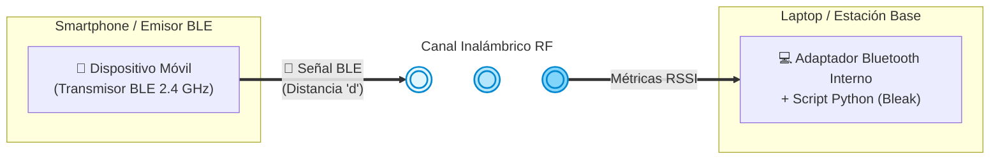

# PIA - H2: Propuesta y primera señal (Parte 2 de 6)

**Universidad Autónoma de Nuevo León**  
**Facultad de Ciencias Físico Matemáticas**  
**Asignatura:** Señales de Transmisión  
**Docente:** Guillermo Ezequiel Sánchez Guerrero  
**Fecha:** 16 de Octubre de 2026  

---

### Datos del Equipo (Grupo D)
| Nombre Completo | Matrícula | Correo Universitario | Rol en el Equipo |
| :--- | :---: | :---: | :--- |
| **Victoria Treviño Martínez** | 2225372 | victoria.trevinom@uanl.edu.mx | Investigadora (Marco Teórico, Gráficas y Desarrollo) y Programadora |
| **Marco Antonio Rivera Moreno** | 2119040 | marco.riveram@uanl.edu.mx | Verificador (Protocolos y Pruebas de Seguridad) |
| **Fabian Solis Flores Rangel** | 2159498 | fabian.floresr@uanl.edu.mx | Programador Principal (Implementación y Cifrado) |
| **Luis Eduardo Téllez García** | 2154647 | eduardo.tellezg@uanl.edu.mx | Analista Cuantitativo (Cálculos Matemáticos y Tasa de Bits) y Finanzas |

---

## 1. Propuesta Técnica del Enlace (C1)

### 1.1 Medio Seleccionado
- **Medio:** Bluetooth Low Energy (BLE) / Bluetooth (Teléfono ↔ Laptop).

### 1.2 Montaje del Enlace (Diagrama / Croquis)
## 1.1 Medio Seleccionado
* **Medio:** Bluetooth Low Energy (BLE) / Comunicación bidireccional (Teléfono Inteligente ⟷ Laptop).
* **Hardware de Interfaz:** Se utilizará el **adaptador Bluetooth interno** integrado de fábrica en la laptop (compatible con la capa BLE nativa del sistema operativo), evitando la necesidad de adquirir adaptadores o hardware externo adicional (costo cero).
* **Software de Adquisición:** Se empleará un **script de desarrollo propio en Python** utilizando la librería asíncrona `bleak`, el cual se encargará de establecer el enlace activo, escanear el entorno y registrar métricas de potencia de señal (RSSI).

## 1.2 Montaje del Enlace (Diagrama / Croquis y Software)



- **Descripción del Montaje:** El teléfono inteligente actúa como emisor enviando tramas de prueba por BLE en la banda de 2.4 GHz hacia la laptop (receptor). Ambos dispositivos se colocan en línea de vista directa a una distancia inicial $d_0 = 1.0\text{ m}$.

### 1.3 Fenómeno Físico y Variable de Estudio

- **Fenómeno Físico a Medir:** Atenuación de la potencia de la señal de radiofrecuencia (RF) recibida en la banda industrial, científica y médica (ISM) de $2.4\text{ GHz}$ mediante Bluetooth Low Energy (BLE). Se captura en tiempo real el indicador de intensidad de la señal recibida ($RSSI$ en $\text{dBm}$) utilizando el adaptador interno de la laptop y la librería asíncrona de Python `bleak`.
- **Variable a Variar:** Distancia física ($d$) entre el dispositivo móvil emisor y la laptop receptora, establecida en un rango de $0.5\text{ m}$ a $5.0\text{ m}$ con incrementos controlados de $0.5\text{ m}$ para evaluar la degradación de la potencia.
- **Procesamiento y Modelado Automatizado:** 
  - Mediante la interfaz gráfica desarrollada en `customtkinter`, el sistema toma las muestras físicas de la señal y aplica el **Modelo de Pérdida por Trayectoria (*Log-Distance Path Loss Model*)**, cuya función matemática describe la caída logarítmica del $RSSI$ respecto a la distancia:
    $$RSSI(d) = RSSI(d_0) - 10 \cdot n \cdot \log_{10}\left(\frac{d}{d_0}\right)$$
    Donde $RSSI(d_0)$ es la potencia de referencia a una distancia inicial $d_0 = 1.0\text{ m}$ y $n$ representa el exponente de pérdida por trayectoria.
  - A partir de este modelo, el script despeja y calcula la **distancia estimada ($\hat{d}$)** en tiempo real:
    $$\hat{d} = d_0 \cdot 10^{\left( \frac{RSSI(d_0) - RSSI(d)}{10 \cdot n} \right)}$$
  - A través de la librería científica `matplotlib`, el software procesa los datos y genera de forma automática una ventana gráfica interactiva que ilustra la curva de atenuación del enlace, permitiendo validar empíricamente la estabilidad del canal de comunicación.

---

A continuación se muestra el comportamiento esperado de la curva de atenuación del $RSSI$ en función de la distancia física, derivado del modelo logarítmico aplicado en las pruebas:

```text
  RSSI (dBm)
  -40 |  *
  -50 |     *
  -60 |        *
  -70 |           *
  -80 |              *
  -90 |                 *
      +-------------------------> Distancia (d)
       0.5m  1.0m  2.0m  3.0m  5.0m
```
    
### 1.4 Lista de Materiales y Costos
| Cantidad | Material / Componente | Función en el Montaje | Costo ($) |
| :---: | :--- | :--- | :---: |
| 1 | Smartphone con Bluetooth / BLE | Emisor de la señal / tramas de prueba | $0.00 (Propietario) |
| 1 | Laptop con adaptador BLE | Receptor y decodificador de datos | $0.00 (Propietario) |
| 1 | Cinta métrica / Flexómetro (5 m) | Medición precisa de la distancia del canal | $0.00 (Disponible) |
| 1 | Entorno Python (Librería Bleak) | Captura y procesamiento de tramas | $0.00 (Open Source) |
| **Total** | | | **$0.00 (Grupo A)** |

---

## 2. Evidencia de Primera Señal, Fuentes y Riesgos (C2)

### 2.1 Video Corto de la Primera Señal
- **Evidencia:** Recuperación exitosa de la primera señal (un bit o tono de prueba en el receptor que demuestra que el enlace está vivo).
- **Enlace al Video:** `[Insertar enlace de evidencia: Google Drive / OneDrive / YouTube]`

### 2.2 Fuentes Verificables (Formato IEEE)
---
Bleak Developers. (2023). Bleak: Bluetooth Low Energy platform Agnostic Klient for Python (Version 0.21.1) [Software de computación]. GitHub. https://github.com/hbldh/bleak<br/>2. Python Software Foundation (Logica del parser CLI): Python Software Foundation. (2026). argparse - Parser for command-line options, arguments and sub-commands (Python Standard Library v3.11) [Software de computacion]. https://docs.python.org/3/library/argparse.html<br/>3. Ejemplo de servidor GATT BLE: Blum, R. (2020). Python Bluetooth LE GATT Server Example [Codigo fuente]. https://github.com/hbldh/bleak/tree/develop/examples.<br/>4 N. Pavur, R. A. Calvo, and J. A. Clark, "Security and Privacy Threats for Bluetooth Low Energy in IoT and Wearable Devices: A Comprehensive Survey," IEEE Xplore, [En línea]. Disponible en: https://ieeexplore.ieee.org/document/9706334 [Accedido: 15-oct-2026].<br/>5. M. Ryan, "Bluetooth: With Low Energy comes Low Security," in Proceedings of the 7th USENIX, [En línea]. Disponible en:
https://www.usenix.org/conference/woot13/workshop-program/presentation/ryan?hl=es-US/ [Accedido: 15-oct-2026].<br/>6. Campus Ciberseguridad, "Seguridad de los dispositivos BLE," Campus Ciberseguridad, [En línea]. Disponible en: https://www.campusciberseguridad.com/blog-alumno/seguridad-de-los-dispositivos-ble/ [Accedido: 15-oct-2026].<hr/><h2>Instalacion y Uso</h2><pre>pip install -r requirements.txt`npython main.py --scan`npython main.py --receive</pre>

### 2.3 Breve Análisis de Riesgos (Seguridad y Legalidad)
 ## Análisis de Riesgos y Legalidad


 - **Riesgos de Seguridad Técnico-Operativos:**
 -    **1. Intercepción de trafico** Dado que los dispositivos BLE se comunican en el canal inalámbrico, cualquier persona con un dispositivo de análisis de paquetes, como Ubertooth o SmartRF Sniffer, puede interceptar la comunicación. Se recomienda a los usuarios utilizar opciones de emparejamiento seguras, como la comparación numérica, el acceso fuera de rango o, al menos, la introducción de una clave de acceso.
-    **2. Ataques de Hombre en el Medio (MitM):** Aquí si el mecanismo de emparejamiento o vinculación es débil, un dispositivo malicioso puede suplantar la identidad de la laptop y/o celular y hasta modificar y alterar el flujo de datos.

## Reglas de Seguridad y Legalidad

- **Uso ético y autorizado:** Las herramientas y scripts desarrollados en este proyecto (como `test_ble.py`) están diseñados exclusivamente con fines académicos y de prueba en entornos controlados, utilizando dispositivos propios para validar conceptos de conectividad de bajo consumo (BLE).
- **Cumplimiento normativo:** Las pruebas de conectividad inalámbrica y la manipulación de interfaces de red deben realizarse respetando las normativas locales vigentes y los marcos regulatorios aplicables a las telecomunicaciones.
- **Privacidad de los datos:** Queda estrictamente prohibido el escaneo no autorizado, la captura de tráfico o la interacción maliciosa con dispositivos pertenecientes a terceros sin su consentimiento explícito.
- **Responsabilidad del usuario:** Los integrantes del equipo son responsables de garantizar que cualquier ejecución de código o prueba de concepto se realice de manera segura, evitando afectaciones a redes ajenas o equipos externos.
 - **
