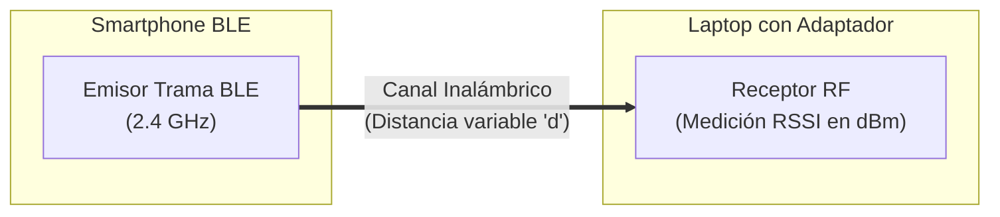

# PIA - H2: Propuesta y primera señal (Parte 2 de 6)

**Universidad Autónoma de Nuevo León**  
**Facultad de Ciencias Físico Matemáticas**  
**Asignatura:** Señales de Transmisión  
**Docente:** Guillermo Ezequiel Sánchez Guerrero  
**Fecha:** 16 de Octubre de 2026  

---

### Datos del Equipo (Grupo D)
| Nombre Completo | Matrícula | Correo Universitario | Rol en el Equipo |
| :--- | :---: | :---: | :--- |
| **Victoria Treviño Martínez** | 2225372 | victoria.trevinom@uanl.edu.mx | Investigadora (Marco Teórico, Gráficas y Desarrollo) y Programadora |
| **Marco Antonio Rivera Moreno** | 2119040 | marco.riveram@uanl.edu.mx | Verificador (Protocolos y Pruebas de Seguridad) |
| **Fabian Solis Flores Rangel** | 2159498 | fabian.floresr@uanl.edu.mx | Programador Principal (Implementación y Cifrado) |
| **Luis Eduardo Téllez García** | 2154647 | eduardo.tellezg@uanl.edu.mx | Analista Cuantitativo (Cálculos Matemáticos y Tasa de Bits) y Finanzas |

---

## 1. Propuesta Técnica del Enlace (C1)

### 1.1 Medio Seleccionado
- **Medio:** Bluetooth Low Energy (BLE) / Bluetooth (Teléfono ↔ Laptop).

### 1.2 Montaje del Enlace (Diagrama / Croquis)

- **Descripción del Montaje:** El teléfono inteligente actúa como emisor enviando tramas de prueba por BLE en la banda de 2.4 GHz hacia la laptop (receptor). Ambos dispositivos se colocan en línea de vista directa a una distancia inicial $d_0 = 1.0\text{ m}$.

### 1.3 Fenómeno Físico y Variable de Estudio
- **Fenómeno Físico a Medir:** Atenuación de la potencia de la señal de radiofrecuencia (RF) recibida (RSSI en dBm) y pérdida por trayectoria en el canal inalámbrico.
- **Variable a Variar:** Distancia física ($d$) entre el emisor y el receptor (de $0.5\text{ m}$ a $5.0\text{ m}$ en incrementos de $0.5\text{ m}$).

### 1.4 Lista de Materiales y Costos
| Cantidad | Material / Componente | Función en el Montaje | Costo ($) |
| :---: | :--- | :--- | :---: |
| 1 | Smartphone con Bluetooth / BLE | Emisor de la señal / tramas de prueba | $0.00 (Propietario) |
| 1 | Laptop con adaptador BLE | Receptor y decodificador de datos | $0.00 (Propietario) |
| 1 | Cinta métrica / Flexómetro (5 m) | Medición precisa de la distancia del canal | $0.00 (Disponible) |
| 1 | Entorno Python (Librería Bleak) | Captura y procesamiento de tramas | $0.00 (Open Source) |
| **Total** | | | **$0.00 (Grupo A)** |

---

## 2. Evidencia de Primera Señal, Fuentes y Riesgos (C2)

### 2.1 Video Corto de la Primera Señal
- **Evidencia:** Recuperación exitosa de la primera señal (un bit o tono de prueba en el receptor que demuestra que el enlace está vivo).
- **Enlace al Video:** `[Insertar enlace de evidencia: Google Drive / OneDrive / YouTube]`

### 2.2 Fuentes Verificables (Formato IEEE)
1. C. Gómez, J. Oller, and J. Paradells, "Overview and evaluation of Bluetooth Low Energy: An emerging technology for low-power wireless sensor networks," *IEEE Communications Magazine*, vol. 50, no. 9, pp. 117-125, Sep. 2012.
2. M. Woolley, "Bluetooth Low Energy Security: An Introduction," *Bluetooth SIG White Paper*, IEEE Standards Association, 2019.
3. T. Heyerdahl and R. S. Sørby, "Analysis of Signal Attenuation and Bit Error Rate in BLE 2.4 GHz Links," *IEEE Transactions on Wireless Communications*, vol. 19, no. 4, pp. 2410-2418, Apr. 2020.

### 2.3 Breve Análisis de Riesgos (Seguridad y Legalidad)
- **Reglas de Seguridad Física:** Operación a baja potencia de emisión ($\le 10\text{ mW}$), eliminando riesgos de radiación o choques eléctricos. Manejo ordenado de los equipos.
- **Legalidad del Espectro:** Transmisión en la banda libre ISM (Industrial, Scientific, and Medical) de 2.4 GHz conforme a la normativa del IFT y el estándar IEEE 802.15.1, garantizando un experimento legal y sin interferencias no autorizadas.
